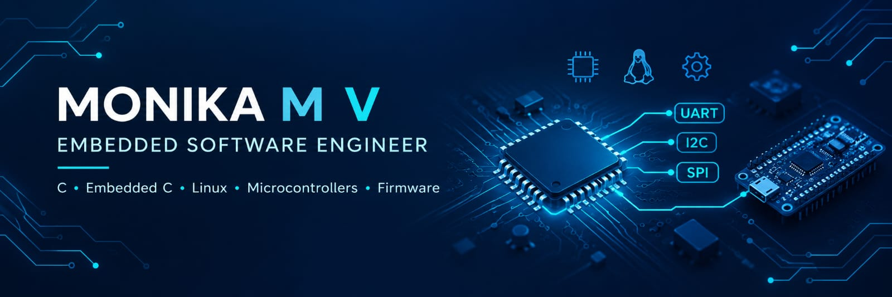

  

<h1 align="center">Hi 👋, I'm Monika M V</h1>
<h3 align="center">Embedded Software Engineer | Firmware | Automation | AI</h3>

  

  
  
  

---

## 🎯 About Me

- 🎓 Electronics and Communication Engineering graduate.
- 💻 Interested in Embedded Software and Firmware Development.
- 🔌 Learning microcontroller programming and hardware-software integration.
- ⚙️ Interested in Industrial Automation and Control Systems.
- 🐧 Exploring Linux, device driver basics, and RTOS concepts.
- 🤖 Interested in AI-driven Embedded Systems and Edge AI.
- 🚀 Focused on building practical projects and strengthening my engineering skills.

---

## 🛠️ Technical Skills

### 💻 Programming Languages

  
  

### 🔌 Embedded Systems & Microcontrollers

  
  
  
  
  

### 🔗 Communication Protocols

  
  
  
  
  

### 🐧 Operating Systems & Development Tools

  
  
  
  
  
  
  

### 🧠 Core Concepts

  
  
  
  
  

---

## 🚀 Featured Projects

### 1. 🖼️ Image Steganography Tool
**Tech Stack:** C | Bitwise Operations | Pointers | File Handling

- Developed a C application to hide and retrieve secret data in BMP images using the LSB technique.
- Implemented encoding, decoding, and validation.
- Processed BMP headers and checked image capacity.

### 2. 🎵 MP3 Tag Reader
**Tech Stack:** C | Structures | Pointers | Binary File Handling

- Developed a command-line application to read and modify MP3 metadata.
- Implemented handling of title, artist, album, and year.
- Used modular programming and input validation.

### 3. 🔍 Lexical Analyser
**Tech Stack:** C | File Handling | Pointers | Modular Programming

- Developed a lexical analyzer to identify keywords, identifiers, operators, constants, and special symbols.
- Implemented token classification and lexical error validation.
- Generated reports containing token counts and detected errors.

### 4. 🌡️ Temperature-Based Fan Control Simulation
**Tech Stack:** MATLAB | Simulink

- Explored electrical system modelling and simulation.
- Studied RL, RC, and RLC circuits.
- Gained exposure to simulation-based engineering analysis.

---

## 📚 Currently Learning

- Embedded C and microcontroller architecture
- GPIO, timers, interrupts, and peripheral interfacing
- UART, I2C, and SPI communication
- Linux fundamentals and device driver basics
- RTOS concepts and firmware development
- Industrial Automation and AI + Embedded Systems

---

## ⚙️ Areas of Interest

  
  
  
  
  

---

## 🎓 Education

**B.E. Electronics and Communication Engineering**  
Government College of Engineering, Thanjavur  
CGPA: 8.25

---

## 🤝 Let's Connect

- 📧 Email: [mvmonika008@gmail.com](mailto:mvmonika008@gmail.com)
- 💼 LinkedIn: [Monika M V](https://linkedin.com/in/monika-m-v)
- 💻 GitHub: [@mvmonika04](https://github.com/mvmonika04)

---

  <i>"Building a strong foundation in embedded systems, one project at a time."</i> 🚀

<!--
**mvmonika04/mvmonika04** is a ✨ _special_ ✨ repository because its `README.md` (this file) appears on your GitHub profile.

Here are some ideas to get you started:

- 🔭 I’m currently working on ...
- 🌱 I’m currently learning ...
- 👯 I’m looking to collaborate on ...
- 🤔 I’m looking for help with ...
- 💬 Ask me about ...
- 📫 How to reach me: ...
- 😄 Pronouns: ...
- ⚡ Fun fact: ...
-->
